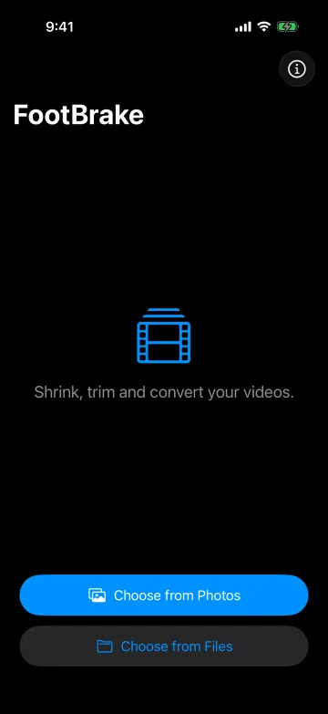
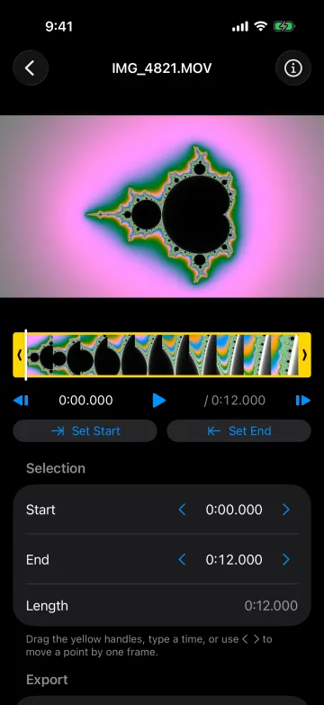
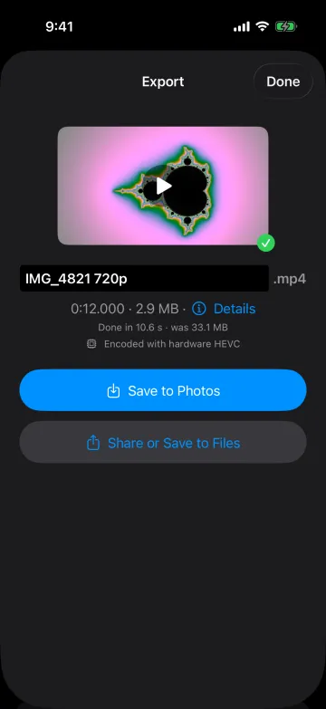
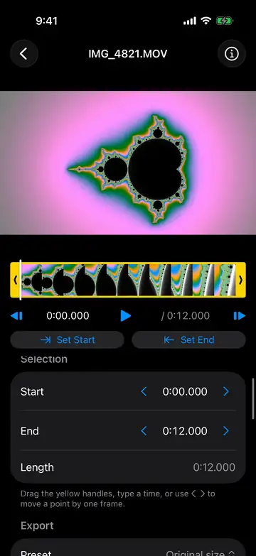
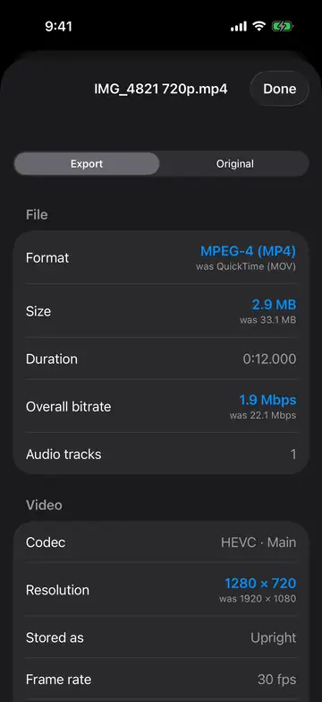

# Gauss

Shrink and trim iPhone videos with the hardware encoder. See `PLAN.md`.

Gauss is free and open source software licensed under GPLv3: no ads, no monetisation, no
telemetry. Gauss will always respect its users.

<p>
  
  
  
</p>

Choose a preset and what metadata to keep, then compare the export with the original:

<p>
  
  
</p>

## Devices

Gauss runs on iPhone and iPad with iOS 16 or later. It has been tested on an iPhone 17 Pro
Max; the iPad version has only been checked in the simulator, as we don't have an iPad to test
on. iPad feedback is very welcome: please open an issue.

## Layout
- `Gauss/`: SwiftUI iOS app (iOS 16+)
- `GaussCore/`: Swift package holding the media engine, the `gauss-cli` Mac test harness, and tests
- `Fixtures/make-fixtures.sh`: generates synthetic test clips into `Fixtures/out/` (needs Homebrew ffmpeg)
- `Config/`: build settings. Copy `Local.xcconfig.example` to `Local.xcconfig` and set your Team ID.

## Common commands
```sh
export DEVELOPER_DIR=/Applications/Xcode.app/Contents/Developer
(cd GaussCore && swift test)                 # engine tests on the Mac
(cd GaussCore && swift run gauss-cli caps)
./Fixtures/make-fixtures.sh
open Gauss.xcodeproj                         # run on iPhone from Xcode
```

## Releasing

`Tools/release.sh` archives the app and uploads it to App Store Connect for TestFlight. It needs
a clean tree that's been pushed to GitHub, and uses the commit count as the build number. The
App Store listing text is in `AppStore/listing.md`.

## Licence

Copyright (C) 2026 Naveen Nathan

Gauss is free software: you can redistribute it and/or modify it under the terms of the
GNU General Public License, version 3, as published by the Free Software Foundation
(SPDX: `GPL-3.0-only`). It is distributed in the hope that it will
be useful, but WITHOUT ANY WARRANTY; without even the implied warranty of MERCHANTABILITY or
FITNESS FOR A PARTICULAR PURPOSE. See `LICENSE` for the full text.

Contributions are accepted under the terms in `CONTRIBUTING.md`. The Gauss name and icon
are not covered by the licence; see `TRADEMARKS.md`.

Icon portrait: Christian Albrecht Jensen, 1840 (public domain), via
[Wikimedia Commons](https://commons.wikimedia.org/wiki/File:Carl_Friedrich_Gauss_1840_by_Jensen.jpg).

Gauss is a homage to the venerable HandBrake. It contains no code from HandBrake; its presets
and VideoToolbox approach were studied as a reference.
